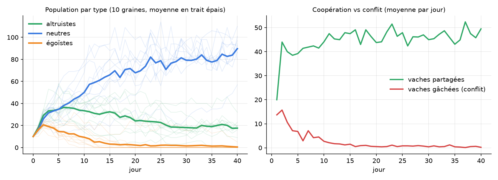

# Enquête - coopération et négociation dans un système multi-agents (Go)

Des agents **altruistes**, **neutres** et **égoïstes** vivent dans un monde 2D.
Ils mangent des **pommes** seuls, mais une **vache** ne peut être chassée qu'à deux :
il faut donc se coordonner par messages et négocier le partage.
Chaque soir, les agents trop faibles meurent et les mieux nourris se reproduisent :
on observe quelle stratégie sociale survit.

## Lancer

Aucune dépendance externe (bibliothèque standard Go >= 1.22).

```bash
go run .                                   # tableau de bord : http://localhost:8080
go run . -headless -jours 40 -csv out.csv  # simulation rapide (sans interface ==> pas de serveur web ni de tableau de bord) + export CSV
go run . -seed 7 -altruistes 20 -egoistes 5
go run . -llm mistral                      # négociations décidées par un LLM local (Ollama)
go test -race ./...                        # tests + détecteur de courses
```

Pour le mode LLM : installer Ollama, puis `ollama pull qwen2.5:1.5b`.
Chaque décision est journalisée dans `decisions_llm.jsonl` (décision, justification, latence, repli éventuel).
Les résultats de la simaulation avec LLM n'ont pas pu être analysées à cause d'un problème de latence.

## Architecture

```
main.go              options en ligne de commande, mode web ou sans interface
sma/
  config.go          tous les paramètres (pour ne plus avoir de constantes et de variables éparpillées comme dans la version 1
  types.go           Pos, TypeAgent, Objet, Etat
  agent.go           perception --> délibération --> influence (intention de l'agent, c'est l'environnement qui décide s'il y a changement)
  strategie.go       interface Strategie + comportements à règles
  llm.go             StrategieLLM : LLM local (API Ollama), repli sur règles, journal JSONL
  messages.go        performatifs (PROPOSITION, ACCEPTATION...) et boîtes aux lettres
  monde.go           environnement : cycle influence/réaction, arbitrage, sélection
  pilote.go          boucle de simulation dans sa goroutine, instantanés atomiques
  metriques.go       export CSV
web/
  serveur.go         API HTTP/JSON (état, commandes, CSV)
  static/index.html  supervision temps réel (canvas, sans dépendance)
```

### Un tick = influence / réaction


Les agents ne modifient jamais le monde directement : ils proposent des influences que
l'environnement valide. Résultat : aucune donnée partagée entre goroutines pendant la
délibération, donc ni verrou ni course (vérifié par `go test -race`), et une simulation
reproductible à graine égale malgré le parallélisme (chaque agent a son propre générateur).

Le serveur web ne touche jamais le monde : le `Pilote` publie après chaque tick un instantané
immuable (`atomic.Pointer`) et reçoit les commandes par canal.

### Protocole de chasse

```
A voit une vache --PROPOSITION(vache, demande)--> jusqu'à 3 voisins libres
voisin           --ACCEPTATION | REFUS(raison)--> A
A                --CONFIRMATION-----------------> premier qui accepte
A                --ANNULATION-------------------> acceptations suivantes
binôme engagé    --> rejoint la vache ; abandon (ANNULATION) si trop long ou vache disparue
```

Cas traités : délais d'attente, confirmation tardive, vache mangée par un autre binôme,
**propositions croisées** (A et B se proposent mutuellement la même vache : sans règle,
les deux répondent "occupé" à l'infini (livelock) ; l'agent d'ID le plus grand cède).

### Partage : jeu de négociation de Nash

Au moment du partage, chacun réclame une part  (si la somme dépasse 100 %, la vache est perdue).

| type      | demande quand il propose | accepte une proposition…        | réclame ensuite       |
|-----------|--------------------------|---------------------------------|-----------------------|
| altruiste | 30 %                     | toujours                        | ce qui reste (1 − d)  |
| neutre    | 50 %                     | si le proposant demande ≤ 50 %  | 50 %                  |
| égoïste   | 70 %                     | toujours                        | 70 %                  |


## Résultats (10 graines, 40 jours)



- Les **égoïstes disparaissent** : entre eux (70 + 70) ou avec un neutre (50 + 70), la vache est gâchée.
- Les **neutres dominent** : ils coopèrent, refusent d'être exploités et profitent des altruistes (30 + 50).
- Les **altruistes survivent mais déclinent** : ils ne gâchent jamais rien, mais cèdent souvent la plus grosse part.
- Les conflits chutent quand les égoïstes s'éteignent : la population "apprend" collectivement à coopérer par sélection.

